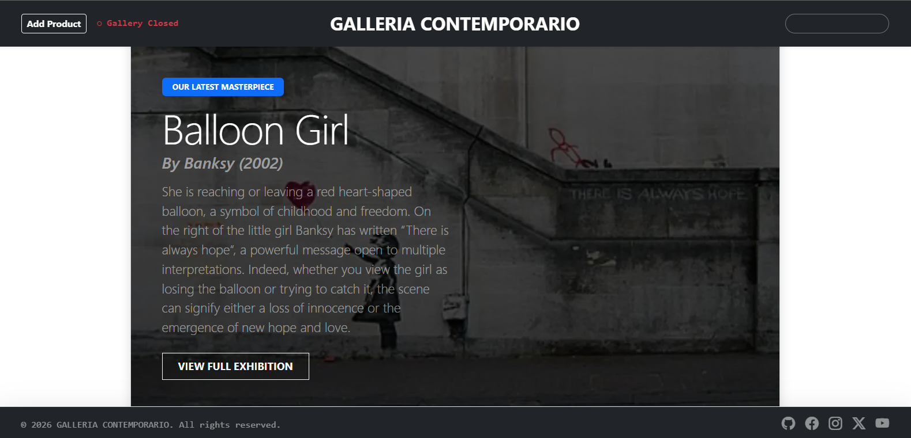
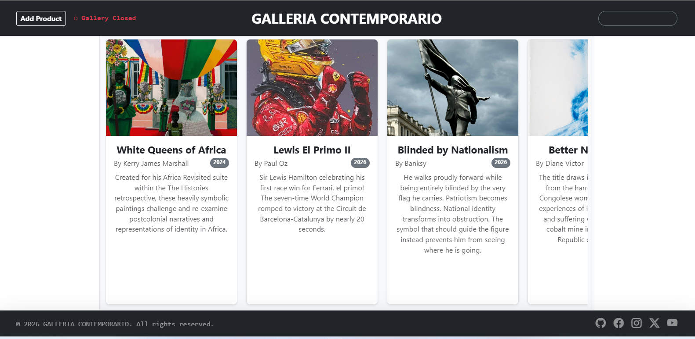

# Galleria Contemporario — Art Exhibition Platform

This application acts as an interactive fine art catalog with an automated infinite image slider gallery loop, dynamic search filters, and an administrative curation desk tool.

# Interface Previews

<table width="100%">
  <tr>
    <td width="50%" align="center">
      <strong>Hero Showcase</strong><br />
      
    </td>
    <td width="50%" align="center">
      <strong>Exhibition Carousel</strong><br />
      
    </td>
  </tr>
</table>


## 1. Setup and Usage Instructions

Follow these chronological terminal commands to clone the project, manage package setups, and run the developer interface sandbox locally on your machine.

### Prerequisites
Ensure you have [Node.js] and npm installed on your local computer before running setup commands.

### Local Installation Steps
1. **Clone the Repository**
   Fork this repository on GitHub to your personal account profile, then clone it down to your machine using your terminal:
   ```bash
   git clone https://github.com/DNNgesa/Creative-Agency
   cd Creative-Agency
   ```

2. **Install Core Dependencies**
   Download all required development packages:
   ```bash
   npm install
   ```

3. **Launch the Local Development Server**
   Boot up the Vite compiler environment tool to preview your exhibition app live inside your local browser layout tab:
   ```bash
   npm run dev
   ```
   *Terminal output will provide a link path (usually `http://localhost:5173/`). Copy and open this address link inside your browser.*

4. **Verify Application Controls**
   * Use the **Add Product** toggle button located on the top-left side of your fixed navbar to reveal or slide away the Curator Panel form interface.
   * Type text keywords into the search box on the top-right navbar layer to filter artwork cards instantly by piece title or artist name.

---

## 2. Application Architecture & Features

### Component Directory Mapping
* **`src/components/AgencyData.jsx`**: Houses your application's raw inventory metadata. It hosts the initial collection dictionary arrays (`initialProducts`) tracking properties like `id`, `title`, `image`, `artist`, `year`, and descriptive body text blocks.
* **`src/components/NavBar.jsx`**: An asymmetric utility navigation block containing layout parameters that fix it to the top viewport ceiling space. It isolates administration controls on the left, centers brand identity, and docks search entries on the right.
* **`src/components/Hero.jsx`**: An index-reactive presentation splash banner. It is programmed using index mathematics (`products[products.length - 1]`) to track state array sizes, automatically applying the latest uploaded painting as a dark backdrop overlay behind main text calls.
* **`src/components/Carousel.jsx`**: A modular infinite horizontal sliding gallery shelf. It relies on clean, native flex row wrappers (`flex-nowrap`, `overflow-hidden`) combined with a React `useRef` hook and `setInterval` clocks to translate display cards smoothly across viewports without relying on external plugins.
* **`src/components/Footer.jsx`**: A structural fixed footer segment pinning legal declarations and automatic copyright calendar year generators down at the bottom of the device viewport grid.
* **`src/components/Timer.jsx`**: Features a background lifecycle component that returns `null` to run silently without rendering visual UI elements. It uses an optimized 5-second interval loop to cross-reference the client's native system clock against pre-set opening parameters (09:00 - 17:00), automatically syncing state properties to swap the navigation header badge layout dynamically between **● Gallery Open** and **○ Gallery Closed**.


### Key Interactive Patterns
* **Unidirectional Data Flow**: Application state variables originate entirely inside the parent ledger wrapper file (`App.jsx`), cascading down into children components as standard immutable data props or function callback listeners (`onToggleAdmin`).
* **Case-Insensitive Double Search Filtering**: The text query engine maps lowercase matching conversions (`.toLowerCase()`) across titles and artist parameters simultaneously, re-rendering elements in real-time.
* **Responsive Blueprint Card Elevations**: Built using standard CSS variables and hardware-accelerated transforms (`will-change`). Rolling a mouse cursor focus pointer over any artwork forces it to lift upward gracefully with a translucent blue drop-shadow glow aura.

---

## 3. Known Project Constraints & Architectural Limitations

### The Client-Side Storage Device Silo
* **The Limitation**: Art pieces created by users are written directly onto *their individual computer's browser cache drive profile*.
* **The Result**: If a user creates an art card on their machine, it will survive page reloads and browser tab restarts, but **it will not be visible to a different user** loading the website from another computer.
